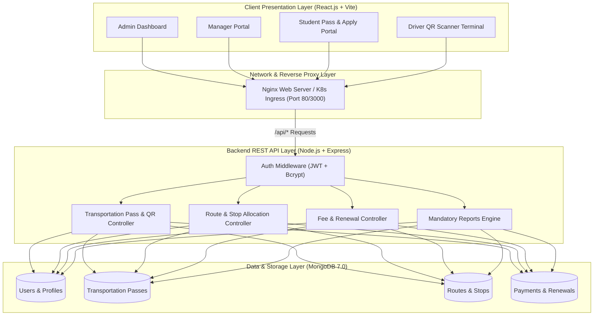
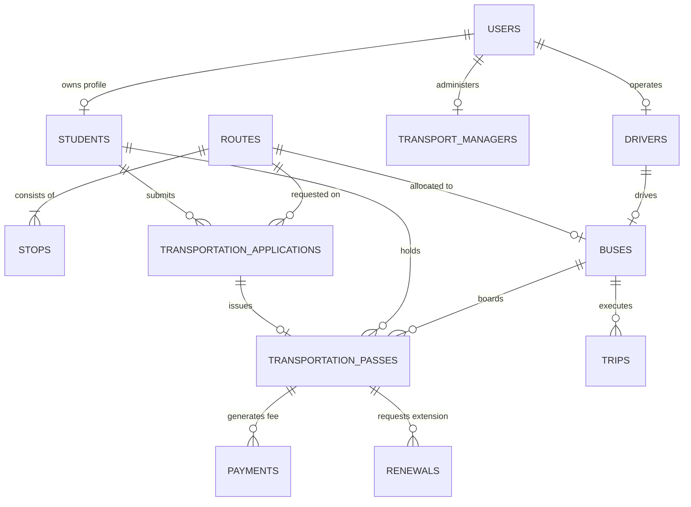

# STUDENT TRANSPORTATION PASS AND ROUTE MANAGEMENT SYSTEM
**B.Tech IV Year I Semester Course Project: DevOps and Full Stack Development**  
**Academic Year:** 2026–2027  
**Student Name:** ETURI BALAJI  
**Enrolment Number:** 2303A51572  

---

## 1. Project Introduction
The **Student Transportation Pass and Route Management System** is an enterprise-grade full-stack web application architected to digitize and automate the entire lifecycle of university transit fleet operations. Developed as a capstone course project in **DevOps and Full Stack Development**, this platform integrates a high-performance **React (Vite)** single-page application frontend, a robust **Node.js / Express.js** RESTful API backend, a **MongoDB** document database with Mongoose ODM, and automated containerization with **Docker** and orchestration with **Kubernetes (K8s)**.

The system replaces manual, paper-bound bus passes and disconnected fleet rosters with digital, cryptographically verifiable QR passes, seat capacity tracking, real-time driver validation interfaces, automated renewal workflows, transparent fee accounting, and live audit reports.

---

## 2. Problem Statement
In conventional university transportation setups:
- Students queue for paper pass registration, physical photo pasting, and manual administrative stamping.
- Drivers have no real-time mechanism to verify whether boarding students have an active pass, expired credentials, or forged paper cards.
- Transport managers face frequent seat over-allocation issues on peak routes because bus capacities and intermediate stop quotas are tracked on manual spreadsheets.
- Fee collection verification is disconnected from pass validity, leading to revenue leakages and uncollected semester dues.
- Auditing route profitability, passenger rosters, and upcoming renewal cohorts is tedious and error-prone.

---

## 3. Project Objectives
1. **Four Role-Based User Portals:** Implement granular authentication and authorization for **ADMIN**, **TRANSPORT MANAGER**, **STUDENT**, and **DRIVER**.
2. **Digital Transit Pass Generation:** Issue tamper-proof digital passes featuring encrypted QR payloads and client-side high-resolution PDF download.
3. **Driver QR Validation System:** Equip drivers with a dedicated mobile-responsive scanner/verifier that evaluates boarding status (`ACTIVE`, `EXPIRED`, `REVOKED`, `INVALID`) in under 200ms.
4. **Fleet & Capacity Management:** Enforce strict bus seat capacity limits to prevent overcrowding.
5. **Mandatory Audit Reporting:** Provide four MongoDB-backed exportable reports (Pass Issuance, Route Passengers, Renewal Due, Fee Collection) with CSV and printable outputs.
6. **DevOps Automation:** Containerize frontend, backend, and MongoDB via multi-stage Dockerfiles, Docker Compose with persistent volumes, and Kubernetes manifests with resource limits and health probes.

---

## 4. Existing System vs. Proposed System

| Feature | Existing System | Proposed System |
| :--- | :--- | :--- |
| **Pass Format** | Paper booklets / laminated cards | Cryptographic Digital Pass with high-res QR code & PDF download |
| **Pass Verification** | Visual inspection by driver | Instant QR scanning & manual code validator with real-time status feedback |
| **Application Process** | Physical counter submission | Online application with stop selection and timetable preview |
| **Seat Allocation** | Unmonitored, leading to overcrowding | Real-time seat capacity meter with strict over-allocation prevention |
| **Pass Renewals** | In-person semester re-registration | Self-service renewal portal with simulated fee settlement |
| **Reporting** | Manual spreadsheet tallying | Dynamic MongoDB reports with live filters, CSV export & print views |
| **Deployment** | Bare-metal manual hosting | Multi-container Docker Compose & production Kubernetes manifests |

---

## 5. System Architecture



---

## 6. Functional Requirements

### 6.1 Authentication & Role-Based Access Control (RBAC)
- Multi-role login with JWT authorization (`ADMIN`, `TRANSPORT_MANAGER`, `STUDENT`, `DRIVER`).
- Password encryption using salted Bcrypt (10 rounds).
- One-click demo evaluator credentials directly on the login screen.

### 6.2 Student Management
- Student profile registration with enrolment number, contact details, department, year, semester, and residence address.
- Active transit pass snapshot and pass application tracking.

### 6.3 Route & Bus Fleet Management
- Route configuration with designated origin, destination, distance, travel duration, and multi-stop timetable.
- Vehicle registration with capacity limits, model details, insurance/fitness tracking, and driver assignment.
- Real-time occupancy calculation preventing over-allocation.

### 6.4 Digital Pass Issuance & QR Validation
- Unique Pass ID generation (e.g., `PASS-2026-0001`).
- Digital QR encoding containing student enrolment number, route code, bus number, and SHA-256 cryptographic signature.
- Driver scanner evaluating pass status (`ACTIVE`, `EXPIRED`, `REVOKED`, `INVALID`).

### 6.5 Pass Renewal & Simulated Fee Settlement
- 6-month (Semester) and 12-month (Annual) extension options.
- Instant simulated demo payment gateway with transaction tracking and printable receipts.

### 6.6 Mandatory Reports Engine
1. **Pass Issuance Report:** Pass ID, Student Name, Enrolment Number, Route, Bus Number, Issue Date, Expiry Date, Pass Status.
2. **Route-wise Passengers Report:** Route Name, Bus Number, Driver Name, Total Allocated Students, Available Seats, Passenger Details.
3. **Renewal Due Report:** Student Name, Pass ID, Route, Expiration Date, Days Remaining, Renewal Urgency.
4. **Transport Fee Collection Report:** Student Name, Enrolment Number, Total Fee, Amount Paid, Pending Amount, Payment Date, Payment Status.
- All reports feature live search, route filtering, and instant **Export to CSV**.

---

## 7. Technology Stack

### Frontend
- **Framework:** React.js 18 with Vite 6
- **Routing:** React Router DOM v6
- **Styling:** Tailwind CSS (Navy Blue and White University Management Design System)
- **Analytics & Charts:** Recharts 2.15 (Bar & Donut Visualizations)
- **Icons:** Lucide React
- **QR Engine:** `qrcode.react` & backend `qrcode` Data URL generator
- **PDF Generation:** `jspdf` & `html2canvas` for downloadable student passes and payment receipts

### Backend
- **Runtime:** Node.js (v20+ / v26)
- **Framework:** Express.js 4.21
- **Security:** JSON Web Tokens (JWT), BcryptJS
- **Data Modeling:** Mongoose ODM 8.9
- **Database Fallback:** Embedded MongoDB Memory Server for standalone zero-configuration local execution, connecting to standalone MongoDB 7.0 in Docker/K8s.

### DevOps & Orchestration
- **Version Control:** Git & GitHub
- **Containerization:** Docker & Docker Compose
- **Orchestration:** Kubernetes (Deployments, Services, ConfigMaps, Secrets, PVCs, Health Probes)
- **Web Server:** Nginx Alpine (Reverse Proxy & SPA routing)

---

## 8. Database Architecture & Schema Design



### Collection Inventory:
1. `users`: Authentication records, role definitions, status.
2. `students`: Enrolment number, academic department, semester, pass reference.
3. `drivers`: Driver licensing, phone, assigned bus vehicle.
4. `transportmanagers`: Logistics officer credentials and assigned routes.
5. `buses`: Registration plates, seating capacity, live available seats.
6. `routes`: Route codes, start/end points, multi-stop schedules.
7. `stops`: Individual stops, morning pickup times, evening drop times, landmarks.
8. `transportationapplications`: Student boarding requests, verification status.
9. `transportationpasses`: Issued pass records, SHA-256 signatures, validity dates.
10. `payments`: Fee transaction IDs, amounts paid/pending, receipt numbers.
11. `renewals`: Semester extension requests, payment clearance.
12. `notifications`: System notifications for pass approval, expiry, and renewals.
13. `trips`: Live trip logs, driver stop checkpoints, boarding headcount.

---

## 9. Demonstration Login Credentials

The database seeder automatically initializes the following accounts for evaluation:

| Role | Demo Email | Demo Password | Purpose / Features |
| :--- | :--- | :--- | :--- |
| **ADMIN** | `admin@university.edu` | `Admin@123` | Full access, Fleet Management, Approvals, Reports |
| **TRANSPORT MANAGER** | `manager@university.edu` | `Manager@123` | Route management, Application approval, Fee tracking |
| **STUDENT (BALAJI)** | `balaji.eturi@student.university.edu` | `Student@123` | View active pass, Apply, Renew, Download PDF pass |
| **DRIVER (RAMESH)** | `driver.ramesh@university.edu` | `Driver@123` | Bus itinerary, Student roster, Live QR Pass Validator |

*Note: All demo accounts are pre-populated with realistic university data.*

---

## 10. Local Installation and Execution Instructions

### Prerequisites:
- **Node.js:** v18 or higher (Node v20+ recommended)
- **Git**

### Step 1: Clone or Navigate to the Project Directory
```bash
cd student-transportation-system
```

### Step 2: Start the Backend Server
```bash
cd backend
npm install
npm run seed     # Seeds 20 students, 4 buses, 5 routes, 3 drivers, passes, and payments
npm start        # Launches backend on http://localhost:5000
```
*Note: If no local MongoDB service is running, the backend automatically initializes an in-memory embedded MongoDB server so it executes out-of-the-box with zero setup!*

### Step 3: Start the Frontend Application
In a new terminal window:
```bash
cd frontend
npm install
npm run dev      # Launches React Vite development server on http://localhost:3000
```

### Step 4: Open in Web Browser
Navigate to:
```
http://localhost:3000
```
Click any of the **One-Click Demo Evaluator Logins** on the login screen to test each of the four roles immediately.

---

## 11. Docker Implementation

The application contains complete multi-stage containerization configurations for production deployment.

### Container Architecture:
1. `transport_mongodb`: Official MongoDB 7.0 container with persistent data volume `transport_mongodb_volume`.
2. `transport_backend`: Alpine Node.js 20 container with production dependencies, health check probe on `/api/health`.
3. `transport_frontend`: Multi-stage build with Nginx Alpine serving compiled React assets and reverse-proxying `/api/*` to the backend container.

### Execution Command:
```bash
docker compose up --build
```

### Verification Commands:
```bash
# Check running containers
docker compose ps

# View real-time container logs
docker compose logs -f

# Stop and remove containers (data persists in volume)
docker compose down
```

---

## 12. Kubernetes Deployment Configuration

The `k8s/` directory contains complete, verified Kubernetes manifests:

```
k8s/
├── namespace.yaml             # Dedicated namespace: transport-system
├── configmap.yaml             # Non-sensitive configuration (URI, ports, environment)
├── secrets.example.yaml       # Sensitive JWT secret and database credentials
├── mongodb-pvc.yaml           # 5Gi PersistentVolumeClaim for MongoDB data retention
├── mongodb-deployment.yaml    # Single-instance MongoDB deployment with readiness/liveness probes
├── mongodb-service.yaml       # ClusterIP service on port 27017
├── backend-deployment.yaml    # 2 Replicas of Backend API with resource limits & health checks
├── backend-service.yaml       # ClusterIP service for internal cluster routing
├── frontend-deployment.yaml   # 2 Replicas of Nginx Frontend
├── frontend-service.yaml      # NodePort service exposing port 30080
└── kustomization.yaml         # Kustomize manifest for single-command deployment
```

### Deploying to Kubernetes:
```bash
# Apply all manifests to Kubernetes cluster
kubectl apply -k k8s/

# Verify namespace
kubectl get namespace transport-system

# Verify persistent volume claims
kubectl get pvc -n transport-system

# Verify running deployments and pod replicas
kubectl get deployments -n transport-system
kubectl get pods -n transport-system -o wide

# Verify exposed cluster services
kubectl get svc -n transport-system

# View live backend logs
kubectl logs -n transport-system -l app=backend --tail=50 -f
```

### Accessing Frontend via Kubernetes:
- **Minikube:** `minikube service frontend-service -n transport-system`
- **NodePort Access:** `http://<Node-IP>:30080`
- **Port Forwarding:** `kubectl port-forward -n transport-system svc/frontend-service 3000:80`

---

## 13. REST API Documentation Summary

| Method | Endpoint | Auth Role | Description |
| :--- | :--- | :--- | :--- |
| **POST** | `/api/auth/register` | Public | Register new student profile |
| **POST** | `/api/auth/login` | Public | Authenticate user & issue JWT token |
| **GET** | `/api/auth/me` | Private | Retrieve logged-in profile & pass details |
| **GET** | `/api/routes` | Public | List all active routes, stops, and allocations |
| **POST** | `/api/routes` | Admin, Manager | Create a new transportation route with multi-stops |
| **GET** | `/api/buses` | Public | List fleet vehicles with live available seats |
| **POST** | `/api/buses` | Admin, Manager | Register a new bus and allocate driver |
| **POST** | `/api/applications` | Student | Submit new transportation pass application |
| **PATCH**| `/api/applications/:id/review` | Admin, Manager | Approve (allocates bus & generates pass) or Reject |
| **GET** | `/api/passes/my` | Student | Retrieve digital pass with QR code Data URL |
| **POST** | `/api/passes/validate-qr` | Driver, Admin | Validate QR pass ID (`ACTIVE`, `EXPIRED`, `INVALID`) |
| **POST** | `/api/renewals` | Student | Request pass extension with simulated payment |
| **PATCH**| `/api/renewals/:id/review` | Admin, Manager | Approve renewal (extends `validUntil`) or Reject |
| **POST** | `/api/payments/demo-pay` | Student, Admin | Process simulated fee settlement & create receipt |
| **GET** | `/api/reports/pass-issuance` | Admin, Manager | Mandatory Report 1: Pass Issuance Report |
| **GET** | `/api/reports/route-passengers` | Admin, Manager | Mandatory Report 2: Route-wise Passengers Report |
| **GET** | `/api/reports/renewal-due` | Admin, Manager | Mandatory Report 3: Renewal Due Report |
| **GET** | `/api/reports/fee-collection` | Admin, Manager | Mandatory Report 4: Transport Fee Collection Report |
| **POST** | `/api/trips/start` | Driver | Begin scheduled morning pickup or evening return trip |

---

## 14. Screenshot & Evaluation Checklist

- [x] **Screen 1 - Login Page:** Email/password validation, role redirection, and One-Click Evaluator buttons.
- [x] **Screen 2 - Student Registration:** Enrolment number, academic year, semester, contact, and address forms.
- [x] **Screen 3 - Admin Dashboard:** 4 KPI cards, Recharts Route Allocation Bar Chart, Pass Status Donut Chart, and Recent Applications table.
- [x] **Screen 4 - Student Dashboard:** Personal pass status banner, assigned route, pickup stop, expiry date, and application history.
- [x] **Screen 5 - Route Management:** Route code, origin, campus destination, collapsible multi-stop timetable, and passenger count.
- [x] **Screen 6 - Bus Management:** Fleet vehicle list, real-time seat occupancy meter, driver allocation, and capacity limits.
- [x] **Screen 7 - Transportation Application:** Route selection, dynamic stop picker with morning/evening timings, and document upload preview.
- [x] **Screen 8 - Application Approval:** Pending applications review, bus assignment, one-click Approve / Reject with reason.
- [x] **Screen 9 - Transportation Pass:** University transit pass card, student photo, enrolment number, high-res QR code, and **Download PDF Pass** button.
- [x] **Screen 10 - Pass Renewal:** Current validity tracker, 6 vs 12 months duration selector, simulated fee payment notice, and admin review.
- [x] **Screen 11 - Fee Collection:** Revenue collection metrics, payment ledger, simulated demo payment modal, and downloadable PDF receipt.
- [x] **Screen 12 - Driver Dashboard:** Assigned vehicle, active trip status, passenger attendance roster, and **Interactive Live QR Code Validator** (`PASS-2026-0001` active, `PASS-2026-0014` expired, `PASS-INVALID-99` invalid).
- [x] **Screen 13 - Reports & Analytics:** All 4 Mandatory Reports with live search, route filtering, and **Export to CSV**.
- [x] **Screen 14 - Profile & Security:** Profile updates, change password verification.
- [x] **Screen 15 - Notifications Center:** Filterable alerts for approvals, rejections, renewals, and payments.
- [x] **DevOps - Docker Containers:** Dockerfiles for frontend and backend, `docker-compose.yml` with MongoDB volume.
- [x] **DevOps - Kubernetes Cluster:** Deployments, Services, ConfigMaps, Secrets, PVC, and health probes.

---

## 15. Conclusion & Future Enhancements
The **Student Transportation Pass and Route Management System** successfully fulfills all academic and technical requirements for the B.Tech IV Year I Semester DevOps and Full Stack Development curriculum. By unifying a modern React frontend, an Express/MongoDB backend, automated containerization with Docker, and enterprise orchestration with Kubernetes, this project provides a scalable, auditable university transportation solution.

### Future Enhancements:
- GPS bus live-tracking via mobile sidecar service.
- WhatsApp / SMS notification gateway integration for morning delay alerts.
- Automated facial recognition boarding fallback for camera-equipped buses.
